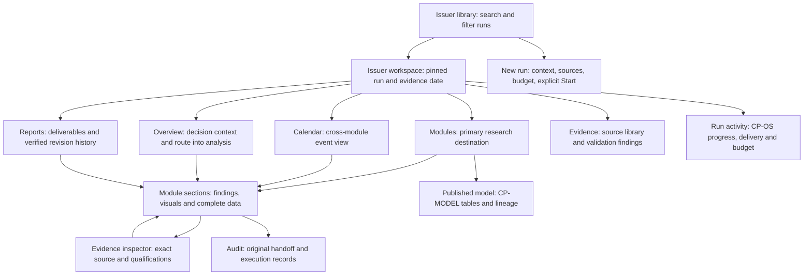
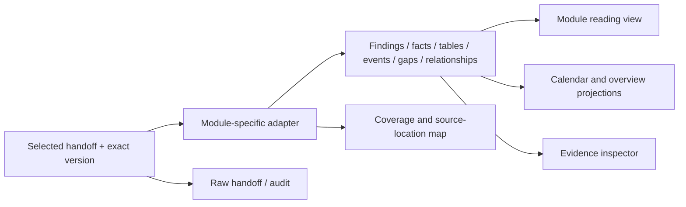

# Issuer research workbench — information architecture

5 November 2026 · Architecture approved; three clickable screen designs delivered as a separate prototype. The production application is unchanged.

## 1. Product decision

**Complete content, designed presentation.** The user confirmed that full module
coverage means all findings and data presented through analyst-focused views,
with the original handoff available in audit. The handoff is a storage and
exchange format. Its Markdown order is not the interface's information hierarchy.

The primary persona is a credit analyst investigating an issuer, forming or
challenging a credit view, and preparing a decision. The secondary persona is a
reviewer who needs the conclusion, its limits and the supporting evidence quickly.
This is an Operate / Read surface for offline Windows laptops and desktops.

The primary journey is:

**Find issuer/run → choose analytical question/module → understand findings →
inspect data and qualifications → follow evidence → return to the same place.**

The new design combines Direction C's persistent module navigation, dense
analytical structure and adjacent evidence inspector with the current app's
raised working surface, spacing and clearer separation of foreground content
from background controls. Keep the supplied symbol, Red Hat type and Deploy VII
colours. No company name or replacement brand.

## 2. What changes structurally

| Current limitation | New information architecture |
| --- | --- |
| One generic reader chooses two leading sections from heading patterns. | A module-specific presentation maps every substantive section to the analyst's questions. |
| Finding modules depends on output availability and a long code-oriented list. | A persistent, searchable catalogue groups modules by purpose; unavailable modules remain discoverable. |
| A chart is usually a transformation of whichever table happens to be eligible. | Each chart has a defined analytical question, source dataset, accompanying interpretation and exact table. |
| Supporting content can disappear into broad disclosures. | Every substantive section is named in the module outline; details expand within that section. |
| Whole Sources or Calculations blocks are treated as audit material. | Classify information within blocks: basis, definitions and consequential limitations stay in the reading view. Only technical detail moves to audit. |
| A readable file can look like a completed analysis. | Availability, analytical acceptance, evidence support and workflow completion remain separate states. |

## 3. Global and issuer-level navigation



**Global rail:** Library, Research workspace, Run activity; Help and Settings at
the bottom. New run remains an explicit labelled action. The rail never becomes
a second list of analytical modules.

**Issuer context bar:** issuer, selected run, workflow, financial/evidence date,
scope and run selector. Output attempt and report revision are separate controls
in their respective destinations. Changing a report revision does not silently
change the analytical output being read.

**Workspace destinations:** Overview, Modules, Calendar, Reports, Evidence.
Modules is the main research surface. Overview offers a short orientation and
links into the same module content, rather than a competing dashboard of copied
analysis. Calendar and Overview are alternative entry points to module-owned data.
There is no separate Charts destination that detaches visuals from their analysis.

**System destinations:** CP-OS appears as Run activity. CP-MODEL appears as
Published model, pinned below the analytical navigator. Both remain searchable by
their canonical IDs. Delivery appears under Reports and is not another analytical
module or a replacement for CP-OS.

## 4. Module discovery and complete module map

Default to **All modules**, grouped by analyst task. Expand the active group and
remember the user's expanded groups. Display name first, CP code second. Search
matches names, codes, aliases, section titles, availability and relevant analytical
topics, plus the current run's figures, source files and retained rows, in the same
groups Deploy VII uses; results open the matching module, section or evidence directly.

Optional filters: This workflow, Outputs available, Needs attention. This workflow
uses an explicit CP-OS plan; a legacy run with no plan says Plan unavailable.
Do not infer not-run or not-applicable states solely from missing files.

Availability labels come from actual evidence: Output available, Inputs only,
No output found; Running/Blocked/Not selected only when recorded by CP-OS.
Selection is blue. Availability does not acquire a positive credit signal.
Aliases resolve to the same canonical module, not duplicate destinations.

The existing catalogue contains **24 canonical entries: 22 analytical modules
and two operational/publication destinations**, plus separate delivery assembly.
All **91 visual specifications** retain a home below. These are planned treatments,
not a claim that every current handoff can populate them.

| Group / module | Analyst-facing name and question | Reading structure and visual treatment | Existing visual IDs |
| --- | --- | --- | --- |
| **Issuer & evidence** · CP-0 | Source readiness — what can this evidence support? | Source/period coverage matrix; readiness by consumer; blocking gaps; document chronology. These are core analysis here, not hidden audit. | CP-0-V01–V03 |
| CP-1A | Business & ownership — how does this company work? | Business model and mix; ownership/control; transactions and capital allocation; event timeline; governance evidence; conflicts and credit implications. | CP-1A-V01–V05 |
| CP-DR | Research questions — what remains unresolved? | Question → answer → evidence; support/contradiction matrix; sector catalysts; peer/transaction research coverage. | CP-DR-V01–V04 |
| **Financial performance** · CP-1 | Financial foundation — what do the reported numbers show? | Scope/basis; financial interpretation; complete statements; history; cash generation; segment mix; EBITDA bridges; debt/maturities; definitions and reconciliations. | CP-1-V01–V08 |
| CP-1B | Earnings changes — what changed since the last period? | Current/prior comparison; margins and operating KPIs; driver evidence; guidance and earnings dates. | CP-1B-V01–V04 |
| CP-L10 | Financial change screen — which changes need deeper work? | Seven-topic change matrix; material/watch judgments; limitations; links to the responsible full modules. | CP-L10-V01–V02 |
| CP-1D | Earnings quality — how much EBITDA is supported? | Issuer-to-supported bridge; add-back evidence/recurrence matrix; cash conversion and leverage restatement. | CP-1D-V01–V03 |
| CP-1C | Peer benchmark — how comparable is the peer evidence? | Comparable universe and exclusions; percent and multiple range strips; outliers; valuation evidence and basis. | CP-1C-V01–V04 |
| **Credit outlook & liquidity** · CP-2 | Fundamental credit view — what supports or weakens the thesis? | Integrated assessment; ranked strengths/weaknesses; financial profile; risk transmission; six-factor matrix; monitoring and view-change evidence. | CP-2-V01–V03 |
| CP-2D | Liquidity — can available resources cover the uses? | Sources/uses bridge; accessible versus restricted resources; cash runway; funding dates and near-term uses. | CP-2D-V01–V04 |
| CP-2A | Downside — what breaks first? | Supplied scenario comparison; assumptions; threshold/cushion ranking; first-break sequence and management levers. | CP-2A-V01–V03 |
| CP-2E | Rates, FX & hedging — what exposure remains? | Rate/FX sensitivities; before/after hedging; residual exposure and hedge expiry lane. | CP-2E-V01–V03 |
| CP-2G | Forward credit model — how does the credit profile evolve? | Actual/forecast scenario series; assumptions; debt/cash metrics; deleveraging and break-point timing. | CP-2G-V01–V03 |
| CP-2H | Ratings & triggers — what could move the rating? | Agency views and divergence; trigger headroom; published actions versus conditional future triggers. | CP-2H-V01–V03 |
| **Capital structure & securities** · CP-3 | Security selection — which instrument is preferred, and why? | Instrument comparison; compensation/recovery cases; preference with conditions; optionality and catalyst dates. | CP-3-V01–V03 |
| CP-3D | Market-implied risk — what does the observed price imply? | Dated quotes and technicals; yield/maturity view; market-implied versus fundamental assumptions. | CP-3D-V01–V03 |
| CP-3C | Refinancing & LME — what can be refinanced, when and on what terms? | Maturity needs; financing burden; alternatives/conditions matrix; execution windows and deadlines. | CP-3C-V01–V04 |
| CP-4 | Legal & covenants — what do the operative documents permit? | Applicable documents and scope; covenant tests; basket conditions; entities/guarantees; priority/control; protection gaps; legal deadlines. | CP-4-V01–V06 |
| CP-4C | Recovery & fulcrum — where does value attach and run out? | Claims and pools; supplied valuation scenarios; allocation waterfalls; recovery by class; fulcrum and conditional treatment. | CP-4C-V01–V05 |
| **Decision & review** · CP-5 | Evidence validation — which claims are supported? | Evaluated claim coverage; support/contradictions; material findings; affected conclusions and remediation. Validation findings stay in the main reading view. | CP-5-V01–V03 |
| CP-6 | Committee decision — what survives challenge? | Thesis → challenge → response → resolution; actual action bias and conditions; portfolio limits when supplied; monitoring commitments. | CP-6-V01–V04 |
| CP-8 | Deliverable comparison — what changed between deliverables, and why? | Report section changes; prior and current material changes; regressions with recheck status; links to the compared reports. | CP-8-V01–V03 |
| **Workspace tools** · CP-MODEL | Published model | Full financial grids; published calculations; source lineage; index of eligible figures linking back to their analytical owner. | CP-MODEL-V01–V02 |
| CP-OS | Run activity | Actual execution/dependency states; delivery completion; spend versus approved cap; resumable state and operational records. | CP-OS-V01–V03 |
| **Reports** · DELIVERY | Deliverables & revisions | Existing pathway designs; verified revision relationships; shared event projection; export/source parity. No CP-MEMO execution. | DELIVERY-V01–V03 |

## 5. Anatomy of a module

```text
GLOBAL RAIL   ISSUER / RUN / EVIDENCE DATE                    Run activity
              Overview  Modules  Calendar  Reports  Evidence

MODULE INDEX  Module name · question it answers              Output version
Search        Scope / basis · explicit acceptance state · material limitations
Task groups   Section outline: every substantive topic, visible and addressable
Names + IDs
Status        FINDINGS + SUPPORTING DATA                     EVIDENCE INSPECTOR
              Authored conclusion / interpretation          Exact selected item
Published     Relevant chart, matrix or timeline            Period, unit, basis
model         Exact table and qualifications                Source / calculation
              Full analysis by topic                        Contradictions / limits
              Gaps and required evidence                    Return to selection

              Related module links                          Audit / original file
```

The page is a complete analytical document, not a two-card extract and not a raw
Markdown transcript. The outline reveals its full scope before the user scrolls.
Substantive sections form a continuous reading path. Large tables can paginate or
virtualise with a visible total and access to every row. Row-level supporting
detail can expand; entire core topics must not depend on finding an unnamed
More disclosure.

Each section answers a question using the right combination of:

- the module's authored finding and interpretation;
- a chart, matrix, timeline, relationship diagram or complete table;
- period, entity, currency, unit, definition and relevant limitations;
- exact evidence links and related module destinations.

The first viewport presents the selected module, its scope, its main finding
when one is supplied, a decision-relevant visual/data block and material warnings.
There is no invented takeaway when the handoff does not provide one.

## 6. Concrete reading structures for the current TDG handoffs

These examples use the retained TDG-002 outputs to test the architecture. They
do not prove acceptance, complete a TDG pathway or generalise issuer-specific facts.

### CP-1 — financial foundation

Reading order: **Scope & reporting basis → Financial interpretation → Performance
→ Cash generation → Balance sheet → Segments → EBITDA definitions & bridges →
Debt & maturities → Definitions & reconciliations → Gaps.**

- Financial interpretation uses the actual Financial read-through, with its
  limitations. Its supporting history is colocated, not in another Charts tab.
- Performance includes the complete income statement, comprehensive income and
  equity supplements. The source-supported dashboard is a view of those facts,
  not a second independent dataset or a substitute for the full statements.
- Cash generation preserves the complete cash-flow statement and separates
  operating cash, capex, acquisition and distribution amounts. Its existing
  bridges remain distinct where definitions differ.
- Entity, U.S. GAAP, USD and quantity/period conventions are visible context.
  Per-share values, share counts, instants and duration flows cannot inherit an
  inappropriate global USD-million label.
- Definition conflicts and unresolved reconciliation differences remain analysis.
  Formula, operands and residuals are available with the affected value.
- Source hashes, full calculation transcripts, execution instructions, publication
  account mappings and consumer handoff logistics sit in audit. None may hide a
  limitation necessary to interpret a displayed value.

### CP-1A — business, transactions and governance

Reading order: **Business & operating model → Mix & concentration → Ownership &
control → Transactions & capital allocation → Events → Governance → Conflicting
evidence & credit implications → Gaps.**

Company, country, sector and business facts become a readable profile, rather
than one long table or an accordion of every basic attribute. Quantified mix can
use bars; unquantified mix remains qualitative. Transactions show date, status,
amount, funding/uses and evidence. The timeline uses those same identities.
Ownership diagrams require explicit relationships. Governance uses the actual
documentary/management/interpretation categories, not invented numeric scores.
Current-liquidity and legal-capacity limitations are surfaced where consequential.

### CP-2 — fundamental credit view

Reading order: **Integrated assessment → Business & competitive position →
Strengths, weaknesses & risks → Financial profile → Outlook & downside chain →
Six-factor matrix → Monitoring & view-change evidence → Gaps.**

The integrated assessment retains its supplied confidence and scope. Arguments
show claim, evidence, credit transmission and counterargument together. The
downside chain can become a labelled sequence only for relationships actually
stated by the module. Qualitative factors stay a labelled matrix; do not turn
Weak/Average/Not Assessable into fabricated numeric radar values. Monitoring
thresholds remain absent when the module has not supplied them.

## 7. What belongs where

| Information | Main reading view | Evidence inspector | Audit / original |
| --- | --- | --- | --- |
| Conclusion, reasoning and contrary evidence | Full substantive content, organised by topic | Exact cited passage and classification | Original wording and location |
| Values, periods, units, definitions and entity scope | Always with the relevant data/visual | Exact string, identity and source row | Source version and raw representation |
| Critical or decision-changing gaps | Visible near the affected finding and in Gaps | Consequence, upstream reference, required evidence | Complete gap records |
| Charts and qualitative diagrams | Beside the corresponding findings | Exact underlying table/relationships | Visual mapping and provenance |
| Calculated results and reconciliation problems | Value, meaning and consequential exceptions | Formula, operands, method and residual | Full calculation script/transcript |
| Analytical source readiness / evidence validation | Core CP-0 / CP-5 content | Claim-to-source trace | Technical execution details only |
| Prompts, requests, hashes, filenames, retry/provider logs | Only a concise operational state if it matters now | A source identity when needed | Full records and raw handoff |
| Unknown/unmapped substantive sections | Additional findings, with a visible outline entry | Original location | Full original also available |

**Audit is a secondary presentation layer, not deletion and not a catch-all for
content the renderer does not understand.**

## 8. Source-to-screen contract

Preserve the current immutable handoffs and reports. Add module-specific
presentation adapters and a local, rebuildable display model. No extra analytical
execution or competing orchestrator is needed.



Each display item needs: owning module; run/output identity; source range or
record ID; exact text/value; relevant entity/period/unit/basis; classification;
limitations; and relationships only where explicitly supplied. The adapter
version is recorded separately from the source revision.

Coverage is assessed per source block and substantive item, not by matching a
few heading keywords. Every item has a destination: structured module content,
readable fallback content, inspector context or technical audit. Unmapped content
must not silently vanish. A missing method-required item is shown as a gap; it is
not manufactured to satisfy the layout. Unassessed requirements remain unassessed.

Reuse existing Deploy VII renderers and qualified figure producers where they
fit. Preserve the visual catalogue's eligibility guards. If a chart lacks a
definition, comparable observations, quantities or legal relationships, show the
available table/text and the specific reason the visual is unavailable. Do not
fill the page with 91 empty chart frames.

## 9. Navigation behaviour and material states

| Situation | Required behaviour |
| --- | --- |
| Open a module | One selection from the persistent index; retain issuer/run context and show every section in the outline. |
| Jump to data or a visual | Search or outline opens the exact section inside the module, not a detached gallery. |
| Inspect a finding/value/event | One action opens adjacent evidence. Close/Escape restores focus to the exact originating item. |
| Follow an upstream module | Deep link to the cited output/section; Back returns to the prior module, version, section and selection. |
| Change output attempt | Explicit selector; distinguish primary designation from saved attempts and independent acceptance. No automatic latest-filename promotion. |
| Change issuer/run | Carry the module/topic when available, but select only that run's files. Otherwise show an explicit unavailable state; never retain the prior issuer's values. |
| Discovery finds newer content | Indicate an update is available. Keep the actively read version pinned until the user chooses to change it. |
| Refresh or bookmark | Restore the addressed run, module, output and section; reject mismatched source versions rather than substituting silently. |
| Module not available | Keep it in the index; explain actual state and known missing inputs. Offer related evidence or another module. |
| Partial adaptation | Keep remaining content readable in Additional findings; expose coverage details in audit. Do not call the module fully adapted when some content exists only in the raw file. |
| Report and library navigation | Report revision remains explicit. Return to the same issuer/module context. Link to module sections only when their relationship is verified. |
| Run execution | CP-OS remains the owner. Context, sources, budget review and explicit Start stay separate from browsing. |

The shared calendar uses lanes for actual issuer events, financial reporting,
funding/maturities, legal deadlines and conditional/watch items. Date precision,
historical versus planned/scenario status and contributing module stay visible.
Undated conditions remain a watchlist. Combine duplicates only with established
shared identity; conflicting descriptions remain separately attributable.

## 10. Hybrid visual and responsive direction

| Keep from Direction C | Keep from the current design | Combined result |
| --- | --- | --- |
| Persistent module index and compact context | Clear issuer identity and comfortable controls | Fast discovery without a wall of CP codes. |
| Structured analytical panels and exact tables | Larger reading zones and purposeful whitespace | Dense data where useful, room for reasoning where needed. |
| Adjacent evidence inspector | Foreground/background separation and subtle depth | Evidence stays part of the workspace; it does not cover the active chart. |
| Qualified call/assessment hierarchy | Restrained elevated surface and modern spacing | A clear analytical lead without a dashboard of decorative cards. |

Use one raised white analytical surface over the cool ground. Group its interior
with headings, rules, alignment and tonal sections, rather than nesting shadow
cards. Findings, period grids, argument matrices and timelines each get their own
appropriate composition. Do not make every module a same-size card grid.

Navy frames the app; blue means action, selection or issuer series. Amber marks
explicit gaps/cautions; green/red require a supplied, qualified positive/adverse
assessment. Grey means neutral/unknown. Workflow state, analytical confidence and
credit quality must not share one undifferentiated colour scale. Keep words and
classification labels, including Not classified, beside the relevant evidence.

On 1280–1440px laptops, keep the module navigator visible by default and compress
the global header. Opening the inspector narrows the analytical canvas and stacks
its internal panels; the evidence pane must not overlay the active visual. Use
approximately 200px navigation and 280–300px inspector as starting constraints,
then prove real content fits. At narrower effective widths/200% zoom, provide a
labelled Modules control and an in-flow evidence view with Back to analysis.
Preserve the active module name and section access even when the index collapses.

## 11. Build sequence and acceptance criteria

This document is the architecture stage. No replacement frontend, new analytical
output, provider execution or historical file mutation is part of this step.

1. **Screen design:** show the module index, CP-1 reading view and open inspector
   at 1366px; also show a qualitative CP-2 view. Use real retained content and the
   selected hybrid direction. Validate the hierarchy before coding the new shell.
2. **One vertical slice:** implement CP-1's complete mapping and navigation; check
   every substantive block against the selected handoff and sent instructions.
3. **Different content shapes:** CP-1A profile/transactions/timeline, then CP-2
   thesis/risk/monitoring. Treat them as separate module acceptance cases.
4. **Remaining modules:** implement adapters one at a time using the map above
   and the existing catalogue guards; do not mistake generic rendering for all
   91 visual specifications being complete.
5. **Shared views and packaging:** reuse the same item identities in Overview,
   Calendar, Published model and Reports; preserve offline Windows operation.

Acceptance checks:

- Every substantive source item is reachable through named module sections;
  zero silent omissions, with technical-only content still available in audit.
- Every canonical module/alias can be found by search, including unavailable ones.
- From a selected run, module selection takes one action; evidence inspection
  takes one action; keyboard Back/Escape restores the correct place.
- Charts, exact tables, interpretation and qualifications stay together.
- All existing 91 visual IDs have an owner and destination; eligibility is checked
  against actual data rather than assumed from the catalogue.
- Issuer/run, output attempt, source date and report revision cannot be confused.
- Browser Back, reload, deep links, output changes and report return preserve
  context without substituting another issuer's or revision's data.
- Laptop and enlarged-view layouts retain readable content, module access and
  evidence return, without page-wide horizontal overflow or chart-covering panes.
- No change to provider execution, CP-OS authority, final-deliverable requirements,
  source values, classifications or analytical conclusions is hidden in the UI work.

## Direction contract — CP-1 / CP-1A / CP-2 screen designs

**THESIS:** Complete module findings become a navigable analytical workspace.
The screen designs are a separate offline HTML prototype, not a replacement
production shell. Every substantive handoff section has a named destination.

**OWN-WORLD:** Direction C navigation and adjacent evidence, current raised white
working surface, cool ground, navy structure, blue selection and issuer series.
Red Hat Display/Text/Mono and the exact supplied symbol; no brand words.

**STORY:** A credit analyst on a well-lit enterprise laptop chooses a module,
reads its findings alongside the relevant visual, inspects exact supporting
fields, and returns without losing the selected module or section.

**FIRST VIEWPORT:** 56px global rail, compact issuer/run header, 196px module
navigator, flexible analytical canvas and 280px evidence inspector. CP-1 pairs
reported trends with the exact table; CP-1A shows dated events without invented
day precision; CP-2 pairs its qualitative assessment with an unscored factor matrix.
The signature interaction is evidence selection with persistent analytical context.

**FORM:** User-pinned hybrid; no direction lottery. The generated CP-1 composition
at `.impeccable/mocks/module-hybrid/cp1.png` guides the screen layout under the
user's delegated design choices. Handoffs, not generated image text, govern all
data, labels and locators. Necessary readability and source-truth corrections
take precedence over image reproduction. No generated raster ships in the UI.

**FINISH:** unreviewed and undocumented is unfinished; this build ends with the
finish review, the verdict, DESIGN.md, and every shipping raster carrying its provenance.
Reviews run inline because this project's user instructions prohibit subagents.

## Basis reviewed (architecture)

- Current PRODUCT.md, DESIGN.md and implemented research.js/workspace-data.js.
- Supplied Direction C workbench reference and its retained first-viewport image;
  current clarified-module-1366 screenshot. Reference financial content is not data.
- docs/visualisations/catalogue.csv and MAP.md: 24 canonical entries, separate
  delivery, 91 visual specifications and their documented eligibility constraints.
- TDG-002 CP-1, CP-1A and CP-2 sent instruction files and retained section structures;
  CP-1 attempt 2, CP-1A attempt 3 and CP-2 attempt 2 as concrete presentation cases.
- prompts/CP-1.md was read as a prepared amendment, not treated as proof it was
  sent or as a replacement for the selected method or actual issuer output.

This is a presentation and navigation proposal, not an analytical acceptance
review, a new credit recommendation or proof of complete workflow delivery.
